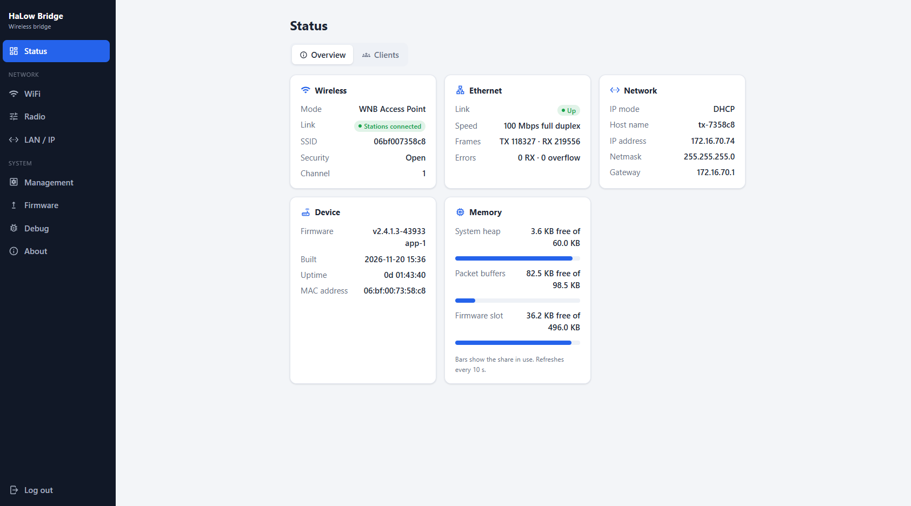
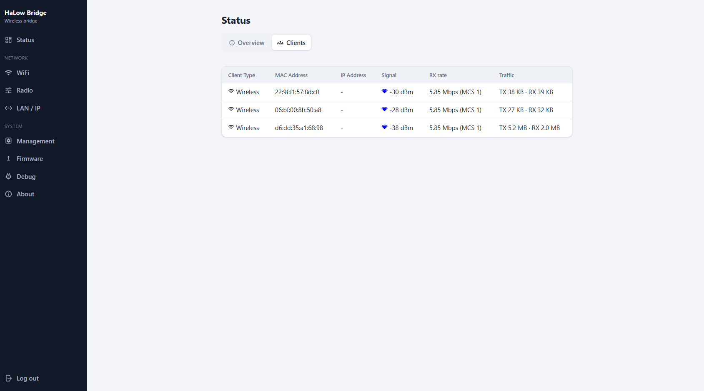
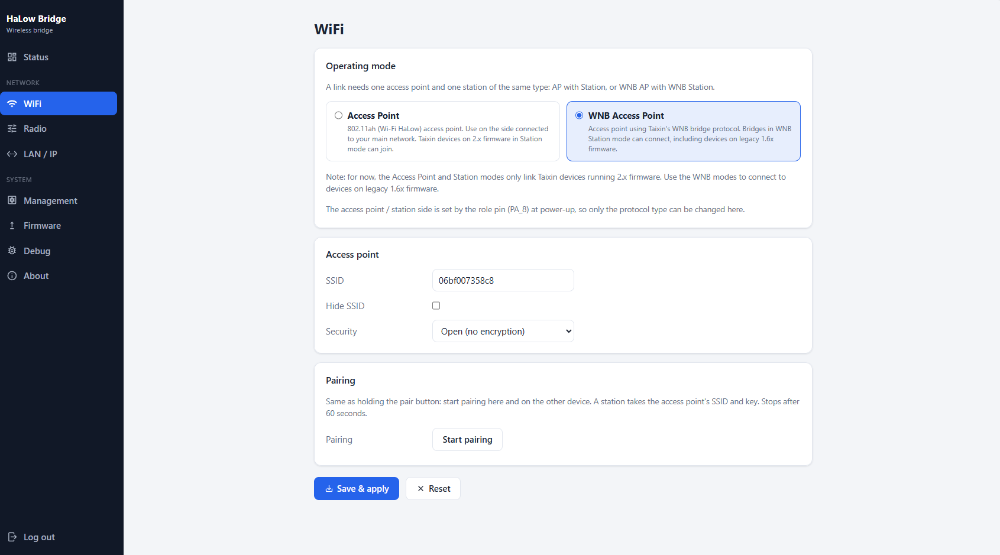
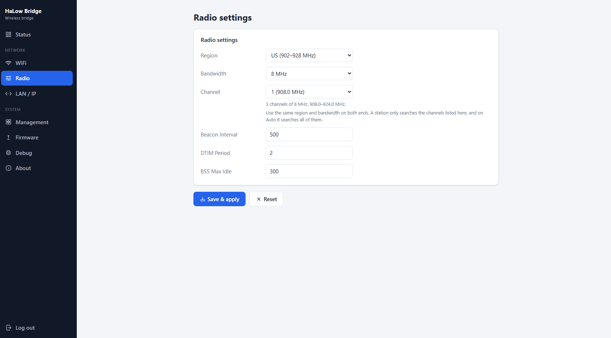
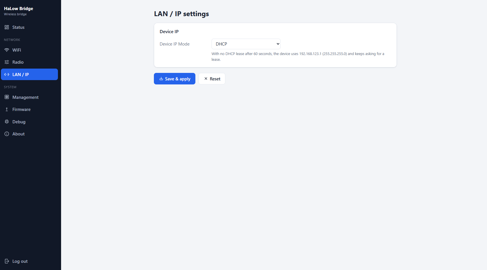
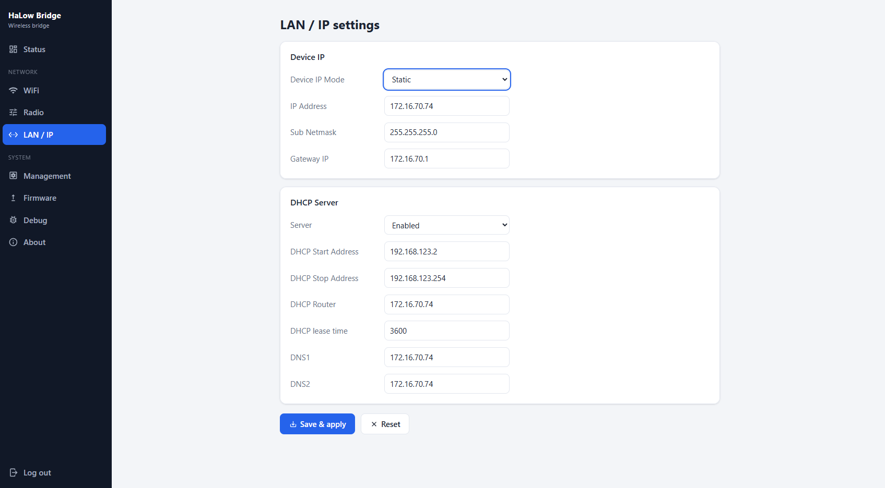
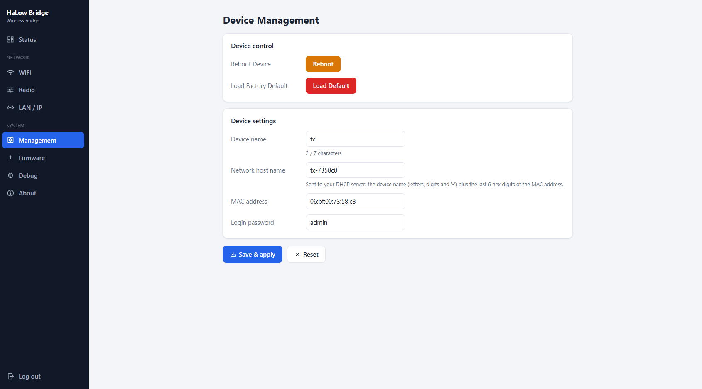
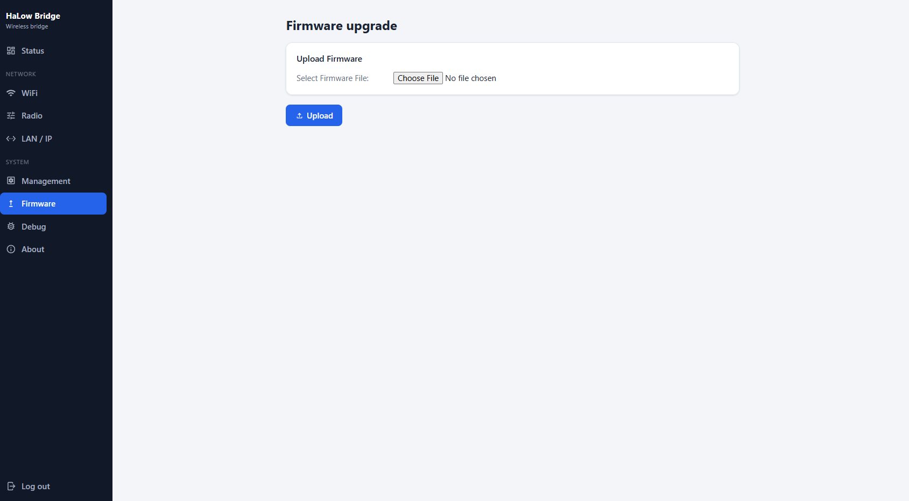
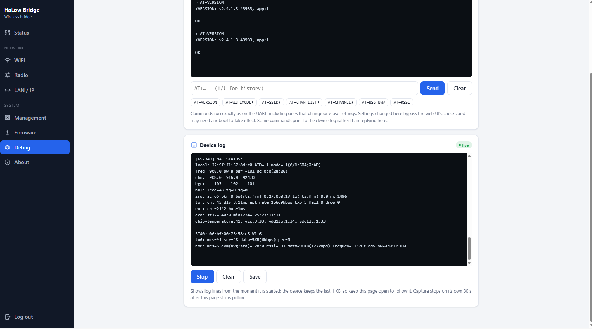

# taixin-halow-bridge

Modifications to the Taixin TXW8301 (TXW4002A) 802.11ah HaLow wireless-bridge (WNB) firmware: an embedded web admin UI, HaLow channel planning, AT command fixes and a DHCP fallback address.

This repository does not contain the vendor SDK. It holds:

| Path | What |
|---|---|
| `patches/` | `git format-patch` series against [Taixin-Semiconductor/TXW8301_WNB](https://github.com/Taixin-Semiconductor/TXW8301_WNB) at `0e273c8` (SDK v2.4.1.3-43933) |
| `web/` | The web admin UI (Vue 3 + Vite). It started from [Taixin-Semiconductor/hgic-wnb-web](https://github.com/Taixin-Semiconductor/hgic-wnb-web) (`2e0384c`) but has diverged too far to keep as a patch, so the full source is here. |
| `scripts/` | `apply.sh` builds the patched firmware tree; `export-patches.sh` writes the patches back out. `upstream.env` pins the vendor commit. |
| `tools/taixin-toolbox/` | Taixin toolbox: a desktop tool (Windows, macOS, Linux) that finds bridges over Ethernet, flashes firmware, resets settings, and talks to stock firmware's NETAT console and NETLOG stream. See its [README](tools/taixin-toolbox/README.md). |
| `docs/` | [WNB OTA protocol](docs/wnb-ota-protocol.md) notes, and the screenshots used below. |

Ready-built firmware is on the [releases page](https://github.com/aliosa27/taixin-halow-bridge/releases).

## Tested hardware

This firmware has been tested on:

- [LILYGO T-Halow](https://lilygo.cc/products/t-halow)
- [LILYGO T-Halow RJ45](https://lilygo.cc/products/t-halow-rj45)
- [Yolefarise WiFi HaLow HTB01](https://www.amazon.com/dp/B0GZNNHVK7). Both Ethernet and USB-C networking work.
- Most Taixin TXW8301 HaLow Ethernet bridges
- [Anjielo HaLow Ethernet bridge kit](https://anjielo.com/products/wireless-signal-wall-through-ethernet-air-connector-port-bridge-kit-outdoor-long-distance-up-to-1000-meters-transmitter-receiver?variant=43940661362905)
- [Anjielo HaLow Wi-Fi extender](https://anjielo.com/products/anjielosmart-ah-wifi-halow-extender-long-distance-wi-fi-outdoor-ap-extender-powerful-high-gain-2-4-5g-antenna-wifi-range-extender-amplifier). This firmware has not been tested on its receiver unit (the side with the 2.4/5 GHz Wi-Fi access point). That unit, on its stock firmware, connects to a device running this firmware in WNB Access Point mode.

## Flashing

Use the `.bin` from a release, or your own `project/txw8301_v<ver>-<svn>_<date>_.bin` (the makecode output). Plain `txw8301.bin` has no OTA header and is rejected. Images are limited to 496 KB (`0x7C000`).

Your saved WiFi, radio and IP settings are kept when you upgrade from stock v2.4.1.3 firmware or from an earlier release. Coming from another major version (for example v1.6.x), reset the settings as part of the upgrade (Taixin toolbox: **Reset settings**). If the saved settings leave the device with no WiFi mode or no IP address, the firmware drops them at boot and starts on its defaults.

### First install: Taixin toolbox

[Taixin toolbox](tools/taixin-toolbox/README.md) (Windows, macOS, Linux; download from the releases page) speaks the same Ethernet OTA protocol as Taixin's program:

1. Connect the PC's Ethernet port to the device's Ethernet port, directly or through a switch, and pick that adapter at the top of the window.
2. On **Firmware (OTA)**, press **Scan** and select the device. Bridges on the far side of a HaLow link answer too.
3. Choose the `.bin` (the tool checks its header and chip ID), keep **Reboot when finished** ticked, and press **Flash**.
4. When moving between major versions (for example stock v1.6.x to this v2.x firmware), also tick **Reset settings** so the device starts from defaults; the tool suggests it when the versions differ.

The same tab has **Reset settings and reboot** to recover a device whose settings leave it unreachable.

### First install: Taixin's OTA program

Devices still on stock firmware have no web UI, so the first install can also go through Taixin's OTA program on a Windows PC. The firmware receives the image as Ethernet frames (`wnb_ota_init`, `SYS_APP_WNBOTA`), so the PC needs a wired connection to the device.

1. Connect the PC's Ethernet port to the device's Ethernet port, directly or through a switch.
2. Start the OTA program and select that Ethernet adapter.
3. Scan for devices. The device shows up by its MAC address.
4. Select the device, choose the `.bin` file, and start the upgrade.
5. Wait for the device to reboot. It then requests an address over DHCP (see [Finding the device](#finding-the-device)).

### Later upgrades: web UI

Open **Firmware**, choose the `.bin`, and press **Upload**. Confirm "Are you sure you want to upgrade?". The device writes the image to the spare OTA slot, then shows "Upgrade successful, reloading in 3 seconds" and reboots. The page reloads on its own.

### Finding the device

- The device gets its address over DHCP. It sends the host name `<device name>-<last 6 MAC hex digits>`, for example `tx-7358c8`, so look for that name in your router's lease list.
- With no DHCP server, use the fallback address http://192.168.123.1 (see below).
- The default web password is `admin`.
- [Taixin toolbox](tools/taixin-toolbox/README.md) finds the device over Ethernet without any IP address (**Firmware (OTA)** → **Scan**).

### Fallback address and DHCP server

With DHCP on (the default), the device falls back to a fixed address when no DHCP server answers, so the web UI stays reachable:

1. **After 60 seconds without a lease**, the device takes **192.168.123.1** (netmask 255.255.255.0, no gateway). It keeps asking for a lease, and a lease replaces the fallback address.
2. **On the station side with no HaLow link**, it also runs a **DHCP server** on that address:
   - It hands out 192.168.123.100–200, with 192.168.123.1 as router and DNS, on 2-minute leases.
   - A PC cabled straight to the device gets an address by itself. Open http://192.168.123.1.
   - The server stops as soon as the HaLow link comes up or a lease arrives, so it never competes with your router's DHCP server across the bridge.
   - The short leases move the PC to your real network within about 2 minutes.
3. **On the access point side, or while the link is up**, nothing is served. Give your PC an address in 192.168.123.0/24 (for example 192.168.123.10) to reach the device.

With a static address (LAN / IP page) there is no fallback. The device keeps the address you set.

### NETAT and NETLOG are off

Stock Taixin firmware runs two UDP broadcast services for Taixin's PC tools: **NETAT** (AT commands over the network) and **NETLOG** (the device log over the network). This firmware turns both off to save SRAM. They are replaced by the web UI's **Debug** page, which has an AT console and a live device log.

- **Taixin's PC tools:** Taixin's NETAT and NETLOG programs get no answer from a device on this firmware. So do the **NETAT console** and **NETLOG** tabs of Taixin toolbox; those tabs are for devices still on stock firmware.
- **Still on:**
  - Ethernet OTA flashing (Taixin's OTA program, and Taixin toolbox's **Firmware (OTA)** tab).
  - AT commands on the serial UART.
- **To turn them back on**, set `SYS_APP_NETAT 1` and/or `SYS_APP_NETLOG 1` in `TXW8301_WNB/project/project_config.h` and rebuild.
  - Cost: about 0.6 KB for NETAT and 0.8 KB for NETLOG.
  - With NETLOG on, the Debug page's device log is not available, because both use the same log hook.

## Web UI

### Status



**Overview** shows the link at a glance:

- **Wireless:** mode, link state, SSID, security and channel.
- **Ethernet:** link, speed and duplex, frame counters, receive errors and overflows.
- **Network:** IP mode, the DHCP host name, and the live address, netmask and gateway.
- **Device:** firmware version, build time, uptime and MAC address.
- **Memory:** free system heap, free packet buffers, and how much of the 496 KB OTA slot the running firmware leaves free.



**Clients** lists each connected peer with its signal, RX link rate (with the MCS), and traffic in each direction. For stations behind a bridge, the IP address is learned from ARP traffic, so it can show `-` until the station has sent some.

### WiFi



- **Operating mode:** standard 802.11ah access point/station, or Taixin's WNB bridge protocol. A link needs one access point and one station of the same type. For now, the standard modes only link Taixin devices on 2.x firmware; the WNB modes also connect to devices on legacy 1.6x firmware.
- The access point or station side is set by the role pin (PA_8) at power-up, so the page only changes the protocol type.
- **Security:** open or WPA-PSK (plus WPA3-SAE/OWE when the firmware supports them), with a passphrase or a raw 64-hex-digit PSK.
- **Pairing:** the same as holding the pair button. Start it here and on the other device; the station takes the access point's SSID and key. It stops after 60 seconds.

### Radio



- Pick the **region** (US 902–928 MHz, EU 863–868 MHz, China 760–784 MHz, or a custom list) and the **bandwidth**. The channel list follows the 802.11ah channel plan, limited to the module's tuning range. Set the same region and bandwidth on both ends; a station only searches the listed channels.
- Beacon interval, DTIM period and BSS max idle.
- **Range and power** (newer than this screenshot):
  - **TX power:** 1–20 dBm.
  - **Power boost:** off, on (the default), 22 dBm only, or 25 dBm only.
  - **Extra ACK timeout:** 0–1000 µs, for links longer than about 1 km. The distance slider fills in the value for you.
  - These settings are saved and applied at boot. The vendor AT commands for them do not save.

### LAN / IP



With DHCP, the page explains the fallback to 192.168.123.1 (see [Fallback address and DHCP server](#fallback-address-and-dhcp-server)).



With a static address, you set the IP, netmask and gateway, and you can run the device's own DHCP server (range, router, lease time, DNS).

### Management



- Reboot, or reset to factory defaults.
- **Device name** (up to 7 characters, with a counter), and a preview of the **network host name** sent to your DHCP server.
- MAC address and login password.

### Firmware



Upload a `.bin` to upgrade, as described under [Later upgrades](#later-upgrades-web-ui).

### Debug



- **AT console:** runs AT commands exactly as on the UART, with history (↑/↓) and quick buttons for common queries. Commands that change or erase settings run too, and they bypass the web UI's checks.
- **Device log:** a live view of the device's log output (what the UART prints), with Start/Stop, Clear and Save to a file. The device keeps the last 1 KB, so keep the page open to follow it. Capture stops on its own 30 seconds after the page stops polling.
- Some commands print to the device log rather than replying in the console. The log above shows the radio status the firmware prints (signal, MCS, EVM, chip temperature).

### About

Source links (this firmware, the vendor SDK and web UI), the releases page for new firmware, and where to report an issue.

## Building

Requirements: Git (Git Bash on Windows), XuanTie CDK with the CK803 toolchain, and Node.js 20 only if you change the UI.

```sh
scripts/apply.sh            # clones the vendor tree into TXW8301_WNB/ and applies patches/
```

Open `TXW8301_WNB/project/txw4002a.cdkproj` in CDK, configuration `BuildSet`, and build. Flash or upload `project/txw8301_v<ver>-<svn>_<date>_.bin` (the makecode output; plain `txw8301.bin` lacks the OTA header).

The patches already contain the built UI (`project/webui_page.h`), so Node is not needed for a firmware-only build.

## Changing the UI

```sh
cd web && npm ci && npm run build
powershell -ExecutionPolicy Bypass -File TXW8301_WNB/project/utilities/gen_webui_page.ps1
```

This regenerates `TXW8301_WNB/project/webui_page.h`. The page is copied into SRAM with the rest of the image at boot, so keep it small (see `NOTES.md` in the patched tree).

## Changing the firmware

`TXW8301_WNB/` is a normal git checkout (branch `bridge`, ignored by this repo). Commit there, then:

```sh
scripts/export-patches.sh   # rewrites patches/ from the commits after the vendor base
git add -A patches && git commit
```

CDK rewrites `txw4002a.mk`, `cdkws.mk`, `*.cdkws` and `*.modify.bat` on every open; the patched tree ignores them.

## Changes from the vendor firmware

- Web admin UI served from the device (`project/webui.c`), as shown above.
- DHCP client: sends the host name `<device name>-<MAC suffix>`, and falls back to 192.168.123.1/24 after 60 s without a lease while it keeps asking for one. A station with no HaLow link also runs a DHCP server on that address until the link comes up or a lease arrives.
- TX power, power boost and extra ACK timeout are saved in the config and applied at boot.
- `AT+SYSCFG` and the new `AT+SCAN?` reply through the AT channel.
- AT commands can be typed in a serial terminal (UART1, 115200 8N1): input is echoed, Backspace works, and Enter runs the line. Tools that send whole lines work as before.
- Removed to save SRAM: `AT+PING`/`AT+IPERF2` (~6 KB), and the NETAT and NETLOG network services (replaced by the Debug page; see [NETAT and NETLOG are off](#netat-and-netlog-are-off)).

Defaults to change before shipping a product: WiFi passphrase `12345678`, web password `admin`.

## License

Apache License 2.0, like both upstream projects. See `LICENSE` and `NOTICE`.
